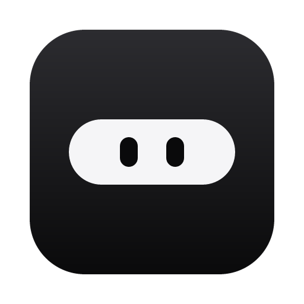

<p align="center">
  
</p>

<h1 align="center">Zaber</h1>

<p align="center">
  A notch for Windows and macOS. Point at the top of the screen and it opens to show what's
  playing, your timer, your to-dos and more. Move the mouse away and it shrinks back to a small pill.
</p>

## Features

- Now playing from any player, with artwork, playback controls and synced lyrics
- A Pomodoro focus timer that counts down in the pill
- To-dos, a notes scratchpad and a water tracker, all saved on your computer
- Today's calendar and the week ahead, with a Join button for meeting links
- A file shelf: drop files on the notch to keep them, then drag them out into any app
- Overlays for volume, brightness, Caps Lock and keyboard language
- Short pop-ups when you plug in the charger, lose Wi-Fi, connect headphones (with their battery
  level) or a USB drive, copy something, take a screenshot or download a file (with its speed while
  it downloads)
- A dot that shows while an app is using your mic or camera
- Claude Code support: answer its permission requests from the notch, see which sessions are
  running and check your plan's 5-hour and weekly usage
- A pair of eyes that dozes off while you're away from the computer

Zaber runs entirely on your computer. It has no account and sends no telemetry, and it only goes
online for features that need to, such as looking up lyrics. [docs/PRODUCT.md](docs/PRODUCT.md)
lists every feature and how far along it is on each OS.

## Install

Download the latest version from this repository's Releases page.

| OS | File |
|---|---|
| Windows 10 / 11 | `Zaber_<version>_x64-setup.exe` |
| macOS (Apple silicon and Intel) | `Zaber_<version>_universal.dmg` |

The builds aren't code-signed yet, so your OS shows a warning the first time you open them.

On Windows, SmartScreen says "Windows protected your PC". Click More info, then Run anyway.

On macOS, open the `.dmg` and drag Zaber into Applications. The first time you open it,
right-click Zaber.app, choose Open, and confirm with Open. You can also allow it from System
Settings → Privacy & Security → Open Anyway.

## Uninstall

In Zaber, open Settings (from the tray icon, or by right-clicking the notch), go to General and
click Uninstall. This removes the app along with its Claude Code hooks and its launch-at-login
entry. On Windows you can also uninstall it from Settings → Apps → Installed apps.

## Build from source

You need [Node.js](https://nodejs.org) 22 or later, [Rust](https://rustup.rs) (stable) and the
[Tauri prerequisites](https://tauri.app/start/prerequisites/) for your OS.

```sh
npm install
npm run tauri dev      # run with hot reload
npm run tauri build    # installer in src-tauri/target/release/bundle/
```

CI runs these checks on both Windows and macOS:

```sh
npm run check && npm test
cd src-tauri && cargo clippy --all-targets -- -D warnings && cargo test
```

The app icon is drawn in `src-tauri/icons/icon.svg`. After you edit it, run
`npx tauri icon src-tauri/icons/icon.svg` to regenerate every size.

## Releasing

1. Bump `version` in `package.json`, `src-tauri/tauri.conf.json` and `src-tauri/Cargo.toml`.
2. Push a tag such as `v0.2.0`. The Release workflow builds the Windows installer and the macOS
   `.dmg` and attaches them to a draft release.
3. Check the draft on GitHub, then publish it.

## Contributing

Issues and pull requests are welcome. Please read [AGENTS.md](AGENTS.md) first. It explains the
architecture and the layout every feature module follows. It also lists the rules the app keeps:
it opens on hover, uses close to no CPU while idle, never takes focus from your work, keeps your
data on your computer and works the same on both OSes.

## License

[MIT](LICENSE). The agent logos in `src/lib/agents/` come from
[LobeHub Icons](https://github.com/lobehub/lobe-icons), which is also MIT licensed (see
`src/lib/agents/LICENSE`).
